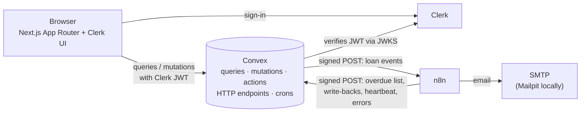
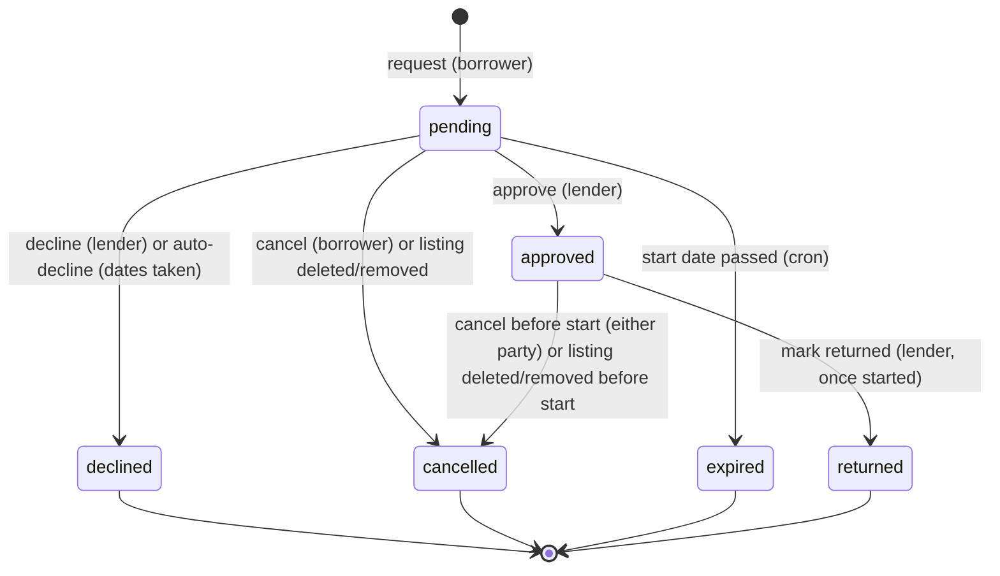
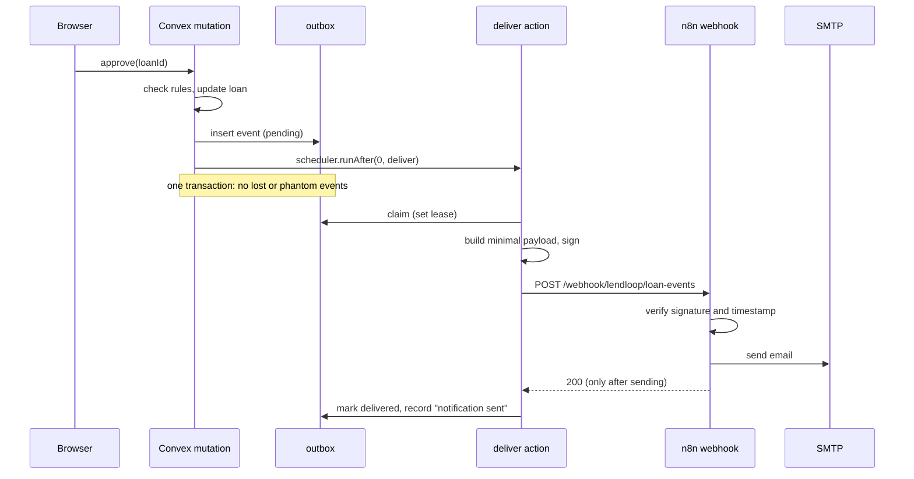
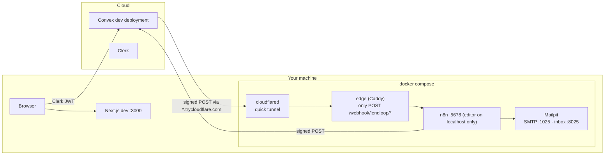

# LendLoop — Architecture

**Status:** Baseline v1.0 (2026-11-10)
**Scope:** Components, module boundaries, the data model, the authorization model, the loan
lifecycle, and the contract between Convex and n8n. This is the authoritative technical reference.
Requirements live in [prd.md](prd.md) and the threat model in [security.md](security.md). The
reasons behind each decision live in the [ADRs](adr/).

---

## 1. Principles

1. **Clerk says who you are. Convex decides what you can do.** Clerk handles sign-in and issues
   the JWT. Every authorization decision is made inside Convex functions. The UI hides what you
   can't do, but enforces nothing ([ADR-002](adr/ADR-002-convex-is-the-authorization-authority.md)).
2. **n8n delivers; it does not decide.** Convex decides who gets notified, and which data they
   get. n8n formats messages, sends them, and runs the schedule
   ([ADR-003](adr/ADR-003-convex-decides-n8n-delivers.md)).
3. **Every boundary is authenticated.** Browser → Convex uses the Clerk JWT. Convex → n8n and
   n8n → Convex each use an HMAC signature with their own secret
   ([ADR-004](adr/ADR-004-hmac-request-signing.md)).
4. **Only the data that is needed crosses a boundary**
   ([security.md §4](security.md#4-data-minimization)).
5. **Every failure ends up recorded where an admin can see it.** Retries are bounded, and dead
   letters, workflow errors and a heartbeat are all visible
   ([ADR-006](adr/ADR-006-failure-visibility.md)).

## 2. System context



| Component | Responsibility |
| --- | --- |
| **Next.js** (App Router) | UI only. Server Components for static shells, Client Components where Convex hooks are needed. `proxy.ts` (Clerk) redirects signed-out users away from app routes, for UX only. |
| **Clerk** | Sign-in, sessions, and the JWT that Convex verifies. |
| **Convex** | Data, business rules, authorization, the outbox, scheduled functions, the HTTP endpoints n8n calls, and crons. |
| **n8n** | Three workflows: loan-event notifications, daily overdue reminders, and an error handler. |
| **Mailpit** | Local SMTP server that catches every email and shows it in an inbox UI ([ADR-007](adr/ADR-007-email-via-smtp-mailpit-locally.md)). |

## 3. Modules and code layout

| Code | Module | Owns |
| --- | --- | --- |
| `PLT` | Platform | Function wrappers, errors, shared validators, dates, signing, the HTTP router, crons, tooling, CI |
| `AUTH` | Identity and roles | `users`, role and trust changes, `auditLog` |
| `TOOL` | Listings | `tools`, availability, the public list |
| `LOAN` | Borrowing | `loans`, the loan state machine, expiry |
| `AUTO` | Automation | `outbox`, `automationEvents`, `workflowRuns`, the n8n endpoints, the n8n workflows |
| `WEB` | Web shell and UX | Layout, navigation, shared components, UX states |

```
convex/
  schema.ts               all tables and indexes
  auth.config.ts          Clerk as the JWT issuer
  convex.config.ts        components (rate limiter)
  http.ts                 HTTP router: /n8n/* endpoints
  crons.ts                outbox sweep, request expiry
  lib/
    functions.ts          publicQuery, userQuery/Mutation, adminQuery/Mutation  ← the only place
                          raw query/mutation builders are imported
    errors.ts             ConvexError codes
    validators.ts         shared v.* validators (category, condition, calendar date)
    domain.ts             categories, conditions, limits (also imported by the UI)
    dates.ts              calendar-date helpers in APP_TIMEZONE
    hmac.ts               sign/verify (Web Crypto)
    env.ts                validated access to environment variables
  model/                  business logic as plain TypeScript, called by the thin functions below
    users.ts tools.ts loans.ts availability.ts automation.ts audit.ts
  users.ts tools.ts loans.ts admin.ts automation.ts dev.ts     registered functions (thin)
  *.test.ts               convex-test suites
src/
  app/                    (public) landing · (app) tools, listings, requests, incoming, admin
  features/               UI by domain: tools/, loans/, admin/, automation/
  components/ui/          shadcn/ui primitives
  lib/                    client helpers (Convex error → message, date formatting)
n8n/workflows/            exported, sanitized workflow JSON
compose.yml               n8n, Mailpit, edge proxy, cloudflared
scripts/                  setup, tunnel sync, n8n import/export/sanitize, ID check, smoke tests
```

Registered functions stay thin: they validate arguments, call `model/*`, and return. This
follows Convex's recommended pattern, and keeps the rules testable in one place.

## 4. Data model

All timestamps are epoch milliseconds (`number`). Loan dates are calendar-date strings
`YYYY-MM-DD` ([ADR-008](adr/ADR-008-calendar-dates-in-one-app-timezone.md)).

### `users`

| Field | Type | Notes |
| --- | --- | --- |
| `tokenIdentifier` | string | From the Clerk identity. Unique, enforced in `ensureUser`. |
| `displayName` | string | "Alex P.", derived from the identity's given and family names |
| `email` | string | Used only for notifications and the contact reveal (BR-16) |
| `role` | `"user" \| "admin"` | Defaults to `"user"`. Changed only by the internal `grantRole`. |
| `isTrustedLender` | boolean | Set by admins (BR-17) |

Indexes: `by_token (tokenIdentifier)`, `by_email (email)` (used by the CLI admin grant).

### `tools`

| Field | Type | Notes |
| --- | --- | --- |
| `ownerId` | `Id<"users">` | |
| `name`, `description` | string | BR-3 limits |
| `category` | union of BR-1 | |
| `condition` | union of BR-2 | |
| `status` | `"active" \| "deleted" \| "removed"` | Soft delete: `deleted` by the owner, `removed` by an admin |
| `removedAt`, `removedBy`, `removedReason` | optional | Set when an admin removes the listing |

Indexes: `by_owner (ownerId, status)`, `by_status_category (status, category)`.

### `loans`

Requests and loans live in one table, because a loan is an approved request.

| Field | Type | Notes |
| --- | --- | --- |
| `toolId`, `lenderId`, `borrowerId` | ids | `lenderId` is copied from the tool at request time, for the incoming index |
| `startDate`, `endDate` | `YYYY-MM-DD` | Inclusive range |
| `note` | optional string | Shown to the lender in the app. Never sent to n8n. |
| `status` | `"pending" \| "approved" \| "declined" \| "cancelled" \| "expired" \| "returned"` | §6 |
| `statusReason` | optional `"dates_taken" \| "cancelled_by_borrower" \| "cancelled_by_lender" \| "listing_deleted" \| "listing_removed"` | |
| `decidedAt`, `cancelledAt`, `returnedAt` | optional number | |

Indexes: `by_tool_status (toolId, status)`, `by_borrower (borrowerId, status)`,
`by_lender (lenderId, status)`, `by_status_end (status, endDate)` (overdue),
`by_status_start (status, startDate)` (expiry).

### `outbox`

One row per loan event that has to reach n8n ([ADR-003](adr/ADR-003-convex-decides-n8n-delivers.md)).
It stores **IDs, not personal data**. The payload is built when it is sent.

| Field | Type | Notes |
| --- | --- | --- |
| `eventId` | string | UUID, sent as `X-LendLoop-Event-Id` and used as the idempotency key |
| `type` | `loan.requested \| loan.approved \| loan.declined \| loan.cancelled \| loan.expired \| loan.returned` | |
| `loanId`, `recipientId` | ids | The recipient is resolved when the event is enqueued (BR-19) |
| `status` | `"pending" \| "delivered" \| "failed"` | `failed` is the dead letter |
| `attempts`, `nextAttemptAt`, `leaseUntil` | number | Retry schedule (§7.3) and the claim lease |
| `lastError`, `lastStatusCode` | optional | Status code and error class only, never response bodies |
| `deliveredAt` | optional number | |

Indexes: `by_status_next (status, nextAttemptAt)`, `by_event (eventId)`, `by_loan (loanId)`.

### `automationEvents`

Per-loan automation activity (AUT-3), and the idempotency store for notification and reminder
records.

| Field | Type | Notes |
| --- | --- | --- |
| `idempotencyKey` | string | `notification:<eventId>` or `reminder:<loanId>:<date>`. Unique (§10). |
| `loanId` | `Id<"loans">` | |
| `kind` | `"notification" \| "reminder"` | |
| `eventType` | optional loan event type | For notifications |
| `recipientRole` | `"lender" \| "borrower"` | |
| `status` | `"sent" \| "failed"` | |
| `detail` | optional string | Short error summary, with no personal data |
| `executionId` | optional string | The n8n execution ID, for cross-referencing |
| `occurredAt` | number | |

Indexes: `by_key (idempotencyKey)`, `by_loan (loanId, occurredAt)`.

### `workflowRuns`

Run summaries (heartbeat) and workflow errors reported by n8n.

| Field | Type | Notes |
| --- | --- | --- |
| `key` | string | `run:<workflow>:<executionId>` or `error:<workflow>:<executionId>`. Unique. |
| `workflow` | `"loan-event-notifications" \| "overdue-reminders" \| "error-handler"` | |
| `kind` | `"run" \| "error"` | |
| `counts` | optional `{ total, sent, failed }` | For runs |
| `node`, `message` | optional string | For errors, truncated and without personal data |
| `executionId` | string | |
| `occurredAt` | number | |

Indexes: `by_key (key)`, `by_workflow_kind (workflow, kind, occurredAt)`.

### `auditLog`

| Field | Type | Notes |
| --- | --- | --- |
| `actorId` | optional `Id<"users">` | Empty for CLI and system actions |
| `action` | `"tool.removed" \| "user.trusted" \| "user.untrusted" \| "user.role_changed" \| "outbox.retried"` | |
| `targetTable`, `targetId` | string | |
| `reason` | optional string | |
| `at` | number | |

Index: `by_at (at)`.

## 5. Authorization

### 5.1 Function wrappers

`convex/lib/functions.ts` builds the only public function builders, using `convex-helpers`
custom functions:

| Builder | Requires | Injects |
| --- | --- | --- |
| `publicQuery` | Nothing. Used only by `tools:listPublic` and `config:get`, which must both declare `returns` validators. | — |
| `identityMutation` | A valid Clerk identity, with no `users` row needed yet. Used only by `users:ensureUser`, which creates that row. | `ctx.identity` |
| `userQuery`, `userMutation` | A valid Clerk identity, plus a `users` row | `ctx.user` |
| `adminQuery`, `adminMutation` | The above, plus `role === "admin"` | `ctx.user` |

- **The acting user always comes from `ctx.auth`.** No public function accepts a user ID for
  "me".
- **Resource checks live in `model/*`:** `assertToolOwner`, `assertLender`, `assertBorrower` and
  `assertLoanParty`. They throw `FORBIDDEN`, or `NOT_FOUND` when the caller may not learn that the
  resource exists.
- **Internal functions** (`internalQuery`, `internalMutation`, `internalAction`) serve n8n (through
  the HTTP endpoints), crons, and CLI operations such as `users:grantRole` and the `dev:*` seeds.
  The `dev:*` functions refuse to run unless `ALLOW_DEV_FUNCTIONS=true`.
- **An ESLint rule** forbids importing `query`, `mutation` and `action` from
  `convex/_generated/server` anywhere except `lib/functions.ts`. Forgetting the wrapper therefore
  becomes a lint error, not a review finding.
- **Errors** are `ConvexError` values with a code: `UNAUTHENTICATED`, `FORBIDDEN`, `NOT_FOUND`,
  `VALIDATION`, `CONFLICT` or `RATE_LIMITED`. The UI turns each code into a plain message.

### 5.2 User records

On sign-in, the client calls `users:ensureUser`. It upserts the row from the identity's claims
(name and email), so later queries can rely on `ctx.user`. Clerk webhooks for profile changes and
deletion are noted for production (block 012).

### 5.3 Permission matrix

| Action | Visitor | `user` | `admin` |
| --- | --- | --- | --- |
| See the public list of available tools (name, category) | ✓ | ✓ | ✓ |
| Browse all tools with status, owner display name and badge | — | ✓ | ✓ |
| Create a listing | — | ✓ | ✓ |
| Edit or delete a listing | — | own | own |
| Remove any listing | — | — | ✓ |
| Request to borrow | — | others' tools | others' tools |
| Approve, decline or mark returned | — | loans on own tools | loans on own tools |
| Cancel | — | per BR-10 | per BR-10 |
| See loans | — | own (as borrower or lender) | all |
| See a counterparty's email | — | approved loans only (BR-16) | approved loans only (own) |
| See a loan's automation activity | — | own loans (as borrower or lender) | all |
| Set Trusted Lender | — | — | ✓ |
| Automation health, retry a dead letter | — | — | ✓ |
| Grant a role | CLI only (internal function) | | |

## 6. Loan lifecycle



- **Overdue is derived**, not stored: an approved loan whose end date is before today.
- Every transition is one mutation, which writes the new status **and** enqueues one outbox
  event in the same transaction.
- Approval runs the overlap check and the auto-decline of overlapping pending requests in the
  same transaction. Convex mutations are serializable, so two approvals racing for the same dates
  cannot both succeed.
- Expiry runs from an hourly cron, which keeps it independent of the cron timezone. It expires
  pending requests whose start date is before today in `APP_TIMEZONE`.

**Availability** (BR-12) is computed when it is read, from `loans.by_tool_status`. At this scale
it is cheap. Denormalizing it is a production consideration.

## 7. Convex → n8n: loan events

### 7.1 Flow



### 7.2 Payload (version 1)

```json
{
  "version": 1,
  "eventId": "9b2f…",
  "type": "loan.approved",
  "occurredAt": "2026-11-10T14:03:00.000Z",
  "recipient": { "name": "Sam K.", "email": "sam@example.com", "role": "borrower" },
  "counterparty": { "name": "Alex P." },
  "tool": { "name": "Cordless drill" },
  "loan": { "id": "k57…", "startDate": "2026-11-12", "endDate": "2026-11-14", "reason": null },
  "link": "http://localhost:3000/requests"
}
```

Nothing else is sent: no descriptions, notes, roles, Clerk IDs, or other users' emails.

Headers: `Content-Type: application/json`, `X-LendLoop-Event-Id`, `X-LendLoop-Timestamp`, and
`X-LendLoop-Signature` (§9).

### 7.3 Delivery and retries

- `automation:deliver` (internal action):
  1. Claims the row through a mutation that sets a 2-minute lease, so a row can't be sent twice
     at once.
  2. Builds the payload through an internal query.
  3. Posts it with a 10-second timeout.
  4. Records the outcome through a mutation.
- **Retryable outcomes:** a network error or timeout, 404 (the workflow isn't active yet), 408,
  425, 429, and 5xx. **Permanent outcomes:** 400, 401, 403, 413 and 422, which mean a contract or
  secret problem that retrying won't fix.
- **Schedule:** retries after 30 s, 2 min, 10 min, 1 h and 6 h, with ±20 % jitter, for 6 attempts
  in total. After that the row becomes `failed`, the dead letter.
- **Sweep:** a cron every 5 minutes re-schedules `pending` rows that are past `nextAttemptAt` and
  have no live lease. Convex runs a scheduled action **at most once**, so a lost run must not
  strand an event.
- **Admin retry** resets a dead letter to `pending` with a fresh attempt budget, and records it
  in the audit log.
- **On 2xx** the row becomes `delivered`, and an `automationEvents` row
  (`notification:<eventId>`) records "notification sent".

## 8. n8n → Convex: HTTP endpoints

All endpoints are `POST` with a JSON body of at most 64 KiB, signed with
`N8N_TO_CONVEX_SIGNING_SECRET`. A bad signature gets a bare `401`, an invalid body `400`, and any
handled request (duplicates included) `200`. Handlers call **internal** functions only.

| Path | Request | Response |
| --- | --- | --- |
| `/n8n/overdue-loans` | `{}` | `{ asOf, loans: [{ loanId, reminderKey, borrower: { name, email }, tool: { name }, endDate, daysOverdue, link }] }`. Loans already reminded successfully today are left out. |
| `/n8n/reminders` | `{ reminderKey, loanId, status: "sent" \| "failed", error?, executionId }` | `{ result: "created" \| "updated" \| "duplicate" }` |
| `/n8n/runs` | `{ workflow, executionId, startedAt, finishedAt, counts: { total, sent, failed } }` | `{ result }` |
| `/n8n/errors` | `{ workflow, executionId, node, message, occurredAt }` | `{ result }` |

## 9. Request signing

The same scheme is used in both directions ([ADR-004](adr/ADR-004-hmac-request-signing.md)):

```
canonical = `${timestamp}.${METHOD}.${path}.${rawBody}`
signature = hex( HMAC-SHA256(secret, canonical) )

X-LendLoop-Timestamp: 1762783380            (unix seconds)
X-LendLoop-Signature: v1=5f2c…              (scheme version prefix)
```

- **Verification:** the timestamp must be within ±300 s; recompute the signature over the
  **raw** body bytes; compare in constant time; reject before parsing JSON.
- **Path** is the URL path only, without host or query. That keeps the signature valid behind
  the tunnel and proxy, while still tying it to one endpoint. A signature captured for
  `/n8n/runs` cannot be replayed against `/n8n/reminders`.
- **Two secrets:** `CONVEX_TO_N8N_SIGNING_SECRET` signs loan events, and
  `N8N_TO_CONVEX_SIGNING_SECRET` signs n8n's calls. A leak in one direction cannot forge the
  other.
- **Replays** inside the 5-minute window are absorbed by idempotency (§10). Anything older is
  rejected.

## 10. Idempotency

Convex has no unique indexes, so uniqueness is enforced inside one mutation: look up by key, then
insert. Mutations are serializable, so two concurrent duplicates conflict; Convex retries the
loser, which then finds the existing row.

| Write | Key | On duplicate |
| --- | --- | --- |
| Notification sent | `notification:<eventId>` | No-op |
| Reminder status | `reminder:<loanId>:<asOf>` | `sent` is final; `failed` → `sent` upgrades; nothing ever downgrades |
| Run summary | `run:<workflow>:<executionId>` | No-op |
| Workflow error | `error:<workflow>:<executionId>` | No-op |

**Delivery is at least once.** n8n replies 2xx only after the email is sent, so the outbox
retries until a send is confirmed. A duplicate email is possible only if the reply is lost after
a successful send. This is the standard webhook trade-off, documented in
[ADR-005](adr/ADR-005-delivery-semantics-and-idempotent-write-backs.md).

## 11. n8n workflows

Exported to `n8n/workflows/`. Secrets are referenced as `$env.*` and n8n credentials, never
written in.

**Loan event notifications** (`loan-event-notifications.json`)
1. Webhook `POST /webhook/lendloop/loan-events` (raw body; responds through a Respond node).
2. Verify the signature (Code node). If it fails, respond `401` and stop.
3. Switch on `type`, then build the plain-text subject and body.
4. Send the email over SMTP, retrying 3 times with a 5-second wait.
5. Respond `200`. If sending still fails, the execution fails, n8n returns `500`, the error
   workflow fires, and Convex retries.

**Overdue reminders** (`overdue-reminders.json`)
1. Schedule trigger daily at 09:00 in `APP_TIMEZONE`, plus a manual trigger.
2. Sign the request and call `/n8n/overdue-loans`.
3. Loop over the loans. For each, email the borrower:
   - On success, write back `sent`.
   - On error, take the error output and write back `failed`. One bad address doesn't stop the
     batch.
4. Post a run summary to `/n8n/runs`; this is the heartbeat.

**Error handler** (`error-handler.json`)
1. Error Trigger. This workflow is set as the error workflow of the other two.
2. Post the error to `/n8n/errors`, with retries. This runs first, so the failure is recorded in
   Convex even when SMTP is the thing that is down.
3. Email `ADMIN_ALERT_EMAIL`: workflow, node, message, execution link.

All of it uses the error details only, never the payload of the failed execution.

## 12. Failure handling and visibility

| Failure | Detected by | Visible as |
| --- | --- | --- |
| n8n unreachable, or returns an error | Outbox retries, then a dead letter | Admin health: dead letters with **Retry** |
| A workflow step fails | n8n error workflow | Admin email, plus an admin health entry |
| One reminder email fails | Per-item error branch | A `failed` reminder on the loan's activity, and in the run counts |
| n8n is down entirely, or the schedule never fires | **Heartbeat:** no `overdue-reminders` run in 26 h | Admin health warning and a navigation badge |
| A Convex function throws | Convex logs | Convex dashboard. Logs carry IDs, never personal data. |

n8n keeps failed executions for 7 days and does not store successful ones, because they contain
email addresses ([security.md §4](security.md#4-data-minimization)).

## 13. Configuration and secrets

| Variable | Lives in | Purpose | Secret |
| --- | --- | --- | --- |
| `NEXT_PUBLIC_CONVEX_URL`, `CONVEX_DEPLOYMENT` | `.env.local` (written by `npx convex dev`) | Convex client and deployment | no |
| `NEXT_PUBLIC_CLERK_PUBLISHABLE_KEY` | `.env.local` | Clerk frontend | no |
| `CLERK_SECRET_KEY` | `.env.local` | Clerk server side (`proxy.ts`) | **yes** |
| `CLERK_JWT_ISSUER_DOMAIN` | Convex env | Clerk JWT issuer for `auth.config.ts` | no |
| `APP_URL` | Convex env | Links in emails | no |
| `APP_TIMEZONE` | Convex env, and `.env` for compose | Calendar "today", and the schedule timezone | no |
| `N8N_LOAN_EVENTS_URL` | Convex env (set by `npm run tunnel:sync`) | Webhook URL | no |
| `CONVEX_TO_N8N_SIGNING_SECRET` | Convex env, and `.env` for compose | Signs loan events | **yes** |
| `N8N_TO_CONVEX_SIGNING_SECRET` | Convex env, and `.env` for compose | Verifies n8n's calls | **yes** |
| `ALLOW_DEV_FUNCTIONS` | Convex env (dev only) | Allows the `dev:*` seed functions | no |
| `N8N_ENCRYPTION_KEY` | `.env` for compose | Encrypts n8n credentials at rest | **yes** |
| `CONVEX_SITE_URL` | `.env` for compose | Base URL of the Convex HTTP endpoints | no |
| `ADMIN_ALERT_EMAIL` | `.env` for compose | Recipient of the error workflow's emails | no |

`npm run setup` generates the secrets (32 random bytes each) into `.env`, and sets the Convex
side with `npx convex env set`, without ever printing a value. `.env.example` documents every
variable.

## 14. Local development topology

Convex dev deployments run in the cloud, so they cannot reach `localhost`
([ADR-001](adr/ADR-001-local-topology-convex-cloud-n8n-tunnel.md)):



The edge proxy means the tunnel exposes **only** the webhook path. The n8n editor and the test
webhooks are not reachable from the internet.

## 15. Testing strategy

| Layer | Tooling | Covers |
| --- | --- | --- |
| Convex functions | Vitest + `convex-test` (edge-runtime environment) | Access rules for every public function, every loan transition (valid and invalid starting states), business-rule boundaries, outbox claim/retry/dead-letter, HTTP endpoints (signatures, bodies, idempotency) |
| Libraries and scripts | Vitest (node) | HMAC against known vectors, date helpers, workflow sanitizer, ID checker |
| Workflows (local stack) | `npm run smoke:*` scripts | Signed event → email in Mailpit (through the Mailpit API); bad signature → 401 and no email; reminder run twice → one email, one record |
| UI | Typecheck, plus a manual QA checklist in each block's completion log | Views and states |

CI runs typecheck, lint, tests, build, the workflow-JSON secret scan and the duplicate-ID check
on every PR.

## 16. Open verification items

These come from the platform versions current on 2026-11-10 (Next.js 16.4, Clerk 7.9, Convex 1.49,
n8n 2.47, TypeScript 7.0). They are checked in the listed block, and the outcome is recorded in
its completion log.

| Item | Block |
| --- | --- |
| TypeScript: pin 6.0.x if `typescript-eslint` still requires `<6.1`; confirm what `create-next-app` installs | 001 |
| Next.js 16 `proxy.ts` (renamed middleware) with Clerk 7's `clerkMiddleware` | 002 |
| Clerk ↔ Convex setup (dashboard integration, `auth.config.ts` format) and which claims carry the name and email | 002 |
| Convex runtime support for `Intl.DateTimeFormat` with `timeZone` | 004 |
| Web Crypto HMAC in Convex actions and HTTP actions | 006 |
| n8n 2.x: `$env` access in Code nodes, `require('crypto')` under task runners, raw webhook body, the status code when a workflow fails before responding, CLI import and activation of workflows and credentials | 007, 008 |
| cloudflared quick-tunnel hostname discovery (metrics endpoint or logs) | 007 |
