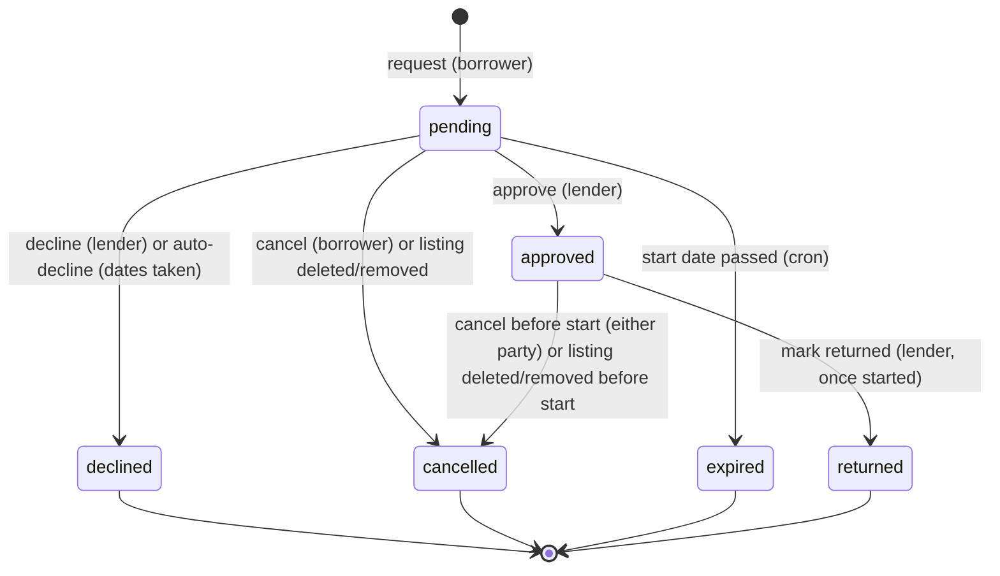
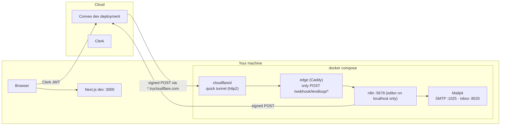

# LendLoop — Architecture

**Status:** Baseline v1.1 (2026-11-10, revised after
[planning review round 1](reviews/planning-baseline-review-1.md))
**Scope:** Components, module boundaries, the data model, the authorization model, the loan
lifecycle, and the contract between Convex and n8n. This is the authoritative technical reference.
Requirements live in [prd.md](prd.md) and the threat model in [security.md](security.md). The
reasons behind each decision live in the [ADRs](adr/).

---

## 1. Principles

1. **Clerk says who you are. Convex decides what you can do.** Clerk handles sign-in and issues
   the JWT. Every authorization decision is made inside Convex functions. The UI hides what you
   can't do, but enforces nothing ([ADR-002](adr/ADR-002-convex-is-the-authorization-authority.md)).
2. **n8n delivers; it does not decide.** Convex decides who gets notified, and which data they
   get. n8n formats messages, sends them, and runs the schedule
   ([ADR-003](adr/ADR-003-convex-decides-n8n-delivers.md)).
3. **Every boundary is authenticated.** Browser → Convex uses the Clerk JWT. Convex → n8n and
   n8n → Convex each use an HMAC signature with their own secret
   ([ADR-004](adr/ADR-004-hmac-request-signing.md)).
4. **Only the data that is needed crosses a boundary, and error text is redacted before it is
   stored** ([security.md §4](security.md#4-data-minimization)).
5. **Every failure ends up recorded where an admin can see it.** Retries are bounded, and dead
   letters, workflow errors, rejected calls and a heartbeat are all visible
   ([ADR-006](adr/ADR-006-failure-visibility.md)).
6. **Anything that depends on time reads a shared clock**, so live views change when the day
   changes ([ADR-008](adr/ADR-008-calendar-dates-in-one-app-timezone.md)).

## 2. System context


| Component | Responsibility |
| --- | --- |
| **Next.js** (App Router) | UI only. Server Components for static shells, Client Components where Convex hooks are needed. `proxy.ts` (Clerk) redirects signed-out users away from app routes, for UX only. |
| **Clerk** | Sign-in, sessions, and the JWT that Convex verifies. |
| **Convex** | Data, business rules, authorization, the outbox, the clock, scheduled functions, the HTTP endpoints n8n calls, and crons. |
| **n8n** | Three workflows: loan-event notifications, daily overdue reminders, and an error handler. |
| **Mailpit** | Local SMTP server that catches every email and shows it in an inbox UI ([ADR-007](adr/ADR-007-email-via-smtp-mailpit-locally.md)). |

## 3. Modules and code layout

| Code | Module | Owns |
| --- | --- | --- |
| `PLT` | Platform | Function wrappers, errors, shared validators, dates, the clock, signing, redaction, the HTTP router, crons, tooling, CI |
| `AUTH` | Identity and roles | `users`, role and trust changes, `auditLog` |
| `TOOL` | Listings | `tools`, availability, the public list |
| `LOAN` | Borrowing | `loans`, the loan state machine, expiry |
| `AUTO` | Automation | `outbox`, `automationEvents`, `workflowRuns`, `integrationStats`, the n8n endpoints, the n8n workflows |
| `WEB` | Web shell and UX | Layout, navigation, shared components, UX states |

```
convex/
  schema.ts               all tables and indexes
  auth.config.ts          Clerk as the JWT issuer
  convex.config.ts        components (rate limiter)
  http.ts                 HTTP router: /n8n/* endpoints
  crons.ts                clock tick, outbox sweep, request expiry
  lib/
    functions.ts          publicQuery, identityMutation, userQuery/Mutation, adminQuery/Mutation
                          ← the only place the raw query/mutation builders are imported
    errors.ts             ConvexError codes
    validators.ts         shared v.* validators (category, condition, calendar date, single-line text)
    domain.ts             categories, conditions, limits (also imported by the UI)
    dates.ts              calendar-date helpers in APP_TIMEZONE; reading the clock
    hmac.ts               sign/verify (Web Crypto)
    redact.ts             strips email-shaped strings, truncates error text
    env.ts                validated access to environment variables
  model/                  business logic as plain TypeScript, called by the thin functions below
    users.ts tools.ts loans.ts availability.ts automation.ts audit.ts clock.ts
  users.ts tools.ts loans.ts admin.ts automation.ts config.ts clock.ts dev.ts   registered functions (thin)
  *.test.ts               convex-test suites; helpers in convex/test/
src/
  app/                    (public) landing · (app) tools, listings, requests, incoming, admin
  features/               UI by domain: tools/, loans/, admin/, automation/
  components/ui/          shadcn/ui primitives
  lib/                    client helpers (Convex error → message, date formatting)
n8n/workflows/            exported, sanitized workflow JSON (stable IDs)
compose.yml               n8n, Mailpit, edge proxy, cloudflared (reads .env.n8n)
infra/Caddyfile           edge proxy allowlist
scripts/                  setup, tunnel sync, admin grant, seed, n8n import/export/check, ID check, smoke tests
```

Registered functions stay thin: they validate arguments, call `model/*`, and return. This follows
Convex's recommended pattern, and keeps the rules testable in one place.

## 4. Data model

All timestamps are epoch milliseconds (`number`). Loan dates are calendar-date strings
`YYYY-MM-DD` ([ADR-008](adr/ADR-008-calendar-dates-in-one-app-timezone.md)). Join dates come from
`_creationTime`.

### `users`

| Field | Type | Notes |
| --- | --- | --- |
| `tokenIdentifier` | string | From the Clerk identity. Unique, enforced in `ensureUser`. |
| `displayName` | string | "Alex P." from the identity's given and family names. If Clerk provides no name: "Neighbor ####", 4 digits derived from the user ID, **never** from the email. Control characters removed; at most 40 characters. |
| `email` | string | Used only for notifications and the contact reveal (BR-16) |
| `role` | `"user" \| "admin"` | Defaults to `"user"`. Changed only by the internal `grantRole`. |
| `isTrustedLender` | boolean | Set by admins (BR-17) |

Indexes: `by_token (tokenIdentifier)`, `by_email (email)` (used by the CLI admin grant).

### `tools`

| Field | Type | Notes |
| --- | --- | --- |
| `ownerId` | `Id<"users">` | |
| `name`, `description` | string | BR-3 limits. The name is single-line, with no control characters. |
| `category` | union of BR-1 | |
| `condition` | union of BR-2 | |
| `status` | `"active" \| "deleted" \| "removed"` | Soft delete: `deleted` by the owner, `removed` by an admin |
| `removedAt`, `removedBy`, `removedReason` | optional | Set when an admin removes the listing |

Indexes: `by_owner (ownerId, status)`, `by_status_category (status, category)`.

### `loans`

Requests and loans live in one table, because a loan is an approved request.

| Field | Type | Notes |
| --- | --- | --- |
| `toolId`, `lenderId`, `borrowerId` | ids | `lenderId` is copied from the tool at request time, for the incoming index |
| `startDate`, `endDate` | `YYYY-MM-DD` | Inclusive range |
| `note` | optional string | Shown to the lender in the app. Never sent to n8n. |
| `status` | `"pending" \| "approved" \| "declined" \| "cancelled" \| "expired" \| "returned"` | §6 |
| `statusReason` | optional `"dates_taken" \| "cancelled_by_borrower" \| "cancelled_by_lender" \| "listing_deleted" \| "listing_removed"` | |
| `decidedAt`, `cancelledAt`, `returnedAt` | optional number | |
| `remindersSent` | number | Starts at 0. Increased once per `sent` reminder (BR-20). |

Indexes: `by_tool_status (toolId, status)`, `by_borrower (borrowerId, status)`,
`by_lender (lenderId, status)`, `by_status_end (status, endDate)` (overdue),
`by_status_start (status, startDate)` (expiry).

### `outbox`

One row per loan event that has to reach n8n ([ADR-003](adr/ADR-003-convex-decides-n8n-delivers.md)).
It stores **IDs, not personal data**. The payload is built when it is sent.

| Field | Type | Notes |
| --- | --- | --- |
| `eventId` | string | UUID, sent as `X-LendLoop-Event-Id` and used as the idempotency key |
| `type` | `loan.requested \| loan.approved \| loan.declined \| loan.cancelled \| loan.expired \| loan.returned` | |
| `loanId`, `recipientId` | ids | The recipient is resolved when the event is enqueued (BR-19) |
| `status` | `"pending" \| "delivered" \| "failed" \| "skipped"` | `failed` is the dead letter. `skipped` means a newer event for the same loan made this one obsolete (§7.3). |
| `attempts`, `nextAttemptAt` | number | §7.3 |
| `leaseUntil`, `leaseToken` | optional | Set by a claim. Only the holder of the current token may record an outcome. |
| `lastErrorCode`, `lastStatusCode` | optional | An error class, never a response body |
| `deliveredAt` | optional number | |

Indexes: `by_status_next (status, nextAttemptAt)`, `by_event (eventId)`, `by_loan (loanId)`. Convex
orders index entries by `_creationTime` last, which gives the per-loan FIFO order.

### `automationEvents`

Per-loan automation activity (AUT-3), and the idempotency store for notification and reminder
records.

| Field | Type | Notes |
| --- | --- | --- |
| `idempotencyKey` | string | `notification:<eventId>` or `reminder:<loanId>:<date>`. Unique (§10). |
| `loanId` | `Id<"loans">` | |
| `kind` | `"notification" \| "reminder"` | |
| `eventType` | optional loan event type | For notifications |
| `recipientRole` | `"lender" \| "borrower"` | |
| `status` | `"sending" \| "sent" \| "failed"` | `sending` exists only for reminder claims |
| `leaseUntil` | optional number | Reminder claim lease (§8) |
| `errorCode`, `errorMessage` | optional string | The message is redacted and truncated to 200 characters. **Shown to admins only.** |
| `runId` | optional string | The n8n run that produced the record |
| `occurredAt` | number | |

Indexes: `by_key (idempotencyKey)`, `by_loan (loanId, occurredAt)`.

### `workflowRuns`

Run summaries (heartbeat) and workflow errors reported by n8n.

| Field | Type | Notes |
| --- | --- | --- |
| `key` | string | `run:<runId>` or `error:<errorId>`. Both IDs are UUIDs minted in the workflow, so they stay unique when n8n's own execution IDs restart. Unique. |
| `workflow` | string | A slug such as `overdue-reminders` or `loan-event-notifications`. Unknown values are stored as sent (at most 64 characters), never rejected. |
| `kind` | `"run" \| "error"` | |
| `counts` | optional `{ total, sent, failed }` | For runs |
| `startedAt`, `finishedAt` | optional number | For runs, as reported by n8n |
| `receivedAt` | number | Convex time. Heartbeat age is measured from this, so a skewed n8n clock cannot fake freshness. |
| `node`, `errorCode`, `errorMessage` | optional string | For errors. Redacted and truncated. |
| `executionId` | optional string | For information only; trigger errors don't have one |

Indexes: `by_key (key)`, `by_workflow_kind (workflow, kind, receivedAt)`.

### `integrationStats`

One row per day of inbound rejections, so problems such as clock skew or a wrong secret are
visible.

| Field | Type | Notes |
| --- | --- | --- |
| `day` | `YYYY-MM-DD` | |
| `rejected` | number | Inbound calls rejected (413, 401 or 400) |
| `lastReason` | `"too_large" \| "bad_signature" \| "stale_timestamp" \| "invalid_body"` | |

Index: `by_day (day)`.

### `clock`

A single row, updated hourly by a cron. Queries read it for "today" and "now", so they re-run when
the time changes (§6).

| Field | Type | Notes |
| --- | --- | --- |
| `key` | `"clock"` | |
| `today` | `YYYY-MM-DD` | In `APP_TIMEZONE` |
| `now` | number | The last tick, at hour precision |

Index: `by_key (key)`.

### `auditLog`

| Field | Type | Notes |
| --- | --- | --- |
| `actorId` | optional `Id<"users">` | Empty for CLI and system actions |
| `action` | `"tool.removed" \| "user.trusted" \| "user.untrusted" \| "user.role_changed" \| "outbox.retried" \| "outbox.retried_all"` | |
| `targetTable`, `targetId` | string | |
| `reason` | optional string | |
| `at` | number | |

Index: `by_at (at)`.

## 5. Authorization

### 5.1 Function wrappers

`convex/lib/functions.ts` builds the only public function builders, using `convex-helpers`
custom functions:

| Builder | Requires | Injects |
| --- | --- | --- |
| `publicQuery` | Nothing. Used only by `tools:listPublic` and `config:get`, which must both declare `returns` validators. | — |
| `identityMutation` | A valid Clerk identity, with no `users` row needed yet. Used only by `users:ensureUser`, which creates that row. | `ctx.identity` |
| `userQuery`, `userMutation` | A valid Clerk identity, plus a `users` row | `ctx.user` |
| `adminQuery`, `adminMutation` | The above, plus `role === "admin"` | `ctx.user` |

- **The acting user always comes from `ctx.auth`.** No public function accepts a user ID for
  "me".
- **Resource checks live in `model/*`:** `assertToolOwner`, `assertLender`, `assertBorrower` and
  `assertLoanParty`. The error code is fixed per resource:
  - **Tools** are visible to every signed-in user, so acting on someone else's tool returns
    `FORBIDDEN`.
  - **Loans** are private to their two parties, so a non-party gets `NOT_FOUND`. The error doesn't
    reveal that the loan exists.
- **Internal functions** (`internalQuery`, `internalMutation`, `internalAction`) serve n8n (through
  the HTTP endpoints), crons, and CLI operations such as `users:grantRole` and the `dev:*` seeds.
  The `dev:*` functions refuse to run unless `ALLOW_DEV_FUNCTIONS=true`.
- **An ESLint rule** forbids importing `query`, `mutation` and `action` from
  `convex/_generated/server` anywhere except `lib/functions.ts`. Forgetting the wrapper therefore
  becomes a lint error, not a review finding.
- **Errors** are `ConvexError` values with a code: `UNAUTHENTICATED`, `FORBIDDEN`, `NOT_FOUND`,
  `VALIDATION`, `CONFLICT` or `RATE_LIMITED`. The UI turns each code into a plain message.

### 5.2 User records

On sign-in, the client calls `users:ensureUser`. It upserts the row from the identity's claims
(name and email), so later queries can rely on `ctx.user`. The Clerk instance is configured to
require first and last names. Clerk webhooks for profile changes and deletion are a production
item (TD-001).

### 5.3 Permission matrix

| Action | Visitor | `user` | `admin` |
| --- | --- | --- | --- |
| See the public list of available tools (name, category) | ✓ | ✓ | ✓ |
| Browse all tools with status, owner display name and badge | — | ✓ | ✓ |
| Create a listing | — | ✓ | ✓ |
| Edit or delete a listing | — | own | own |
| Remove any listing | — | — | ✓ |
| Request to borrow | — | others' tools | others' tools |
| Approve, decline or mark returned | — | loans on own tools | loans on own tools |
| Cancel | — | per BR-10 | per BR-10 |
| See loans | — | own (as borrower or lender) | all |
| See a counterparty's email | — | approved loans only (BR-16) | approved loans only (own) |
| See a loan's automation activity | — | own loans: status only | all, with redacted error detail |
| Set Trusted Lender | — | — | ✓ |
| Automation health; retry one or all dead letters | — | — | ✓ |
| Grant a role | CLI only (internal function) | | |

## 6. Loan lifecycle, availability and time



- **Overdue is derived**, not stored: an approved loan whose end date is before today. After
  7 sent reminders a loan is **long overdue**: reminders stop and admins see a flag (BR-20).
- Every transition goes through `transition()` in `model/loans.ts`: one mutation that writes the
  new status **and** enqueues exactly one outbox event, in the same transaction.
- Approval runs the overlap check and the auto-decline of overlapping pending requests in the
  same transaction. Convex mutations are serializable, so two approvals racing for the same dates
  cannot both succeed.
- Expiry runs from an hourly cron. It expires pending requests whose start date is before today.

**Availability** (BR-12) is computed when it is read, from `loans.by_tool_status`. At this scale
it is cheap (TD-004 covers scaling).
- `tools:listPublic` returns only available tools: active, and not on loan today. It returns at
  most 60, newest first.
- `tools:list` is paginated, 20 per page.
- `tools:mine` returns at most 100 tools, each with its availability and pending-request count.

**Time.** Convex caches query results until the data they read changes, so a query that calls
`Date.now()` would never notice midnight passing. Instead:
- An hourly cron writes the `clock` row: `today` in `APP_TIMEZONE`, and `now`.
- Queries take "today" and "now" from it through `lib/dates.ts`, so open views re-run when the day
  changes, and time-based health flags update by themselves.
- Mutations compute the current time directly, because they are never cached.
- If the clock row doesn't exist yet (the first hour after deployment), queries compute the time
  themselves.

## 7. Convex → n8n: loan events

### 7.1 Flow

```mermaid
sequenceDiagram
  participant UI as Browser
  participant M as Convex mutation
  participant O as outbox
  participant A as deliver action
  participant N as n8n webhook
  participant S as SMTP

  UI->>M: approve(loanId)
  M->>M: check rules, update loan
  M->>O: insert event (pending)
  M->>A: scheduler.runAfter(0, deliver)
  Note over M,O: one transaction: no lost or phantom events
  A->>O: claim (lease token, attempts+1)
  A->>A: build minimal payload, sign
  A->>N: POST /webhook/lendloop/loan-events (timeout 30 s)
  N->>N: verify signature and timestamp
  N->>S: send email (no retry inside n8n; workflow timeout 20 s)
  N-->>A: 200 (only after sending)
  A->>O: record outcome with token: delivered, "notification sent" record
```

### 7.2 Payload (version 1)

```json
{
  "version": 1,
  "eventId": "9b2f…",
  "type": "loan.approved",
  "occurredAt": "2026-11-10T14:03:00.000Z",
  "recipient": { "name": "Sam K.", "email": "sam@example.com", "loanRole": "borrower" },
  "counterparty": { "name": "Alex P." },
  "tool": { "name": "Cordless drill" },
  "loan": { "startDate": "2026-11-12", "endDate": "2026-11-14", "reason": null },
  "link": "http://localhost:3000/requests"
}
```

`loanRole` tells the template which wording to use. Nothing else is sent: no loan ID, account
roles, descriptions, notes, Clerk IDs, or other users' emails.

Headers: `Content-Type: application/json`, `X-LendLoop-Event-Id`, `X-LendLoop-Timestamp`, and
`X-LendLoop-Signature` (§9).

### 7.3 Delivery and retries

**Timeouts.** Convex's `fetch` gives up after **30 s**. The n8n notification workflow has an
execution timeout of **20 s**, and its email step does **not** retry. The invariant: n8n always
answers, or gives up, before Convex does. That keeps the outbox the only retry authority
([ADR-005](adr/ADR-005-delivery-semantics-and-idempotent-write-backs.md)).

**Claim** (internal mutation). It succeeds only when all of these hold:
- the row is `pending`;
- `nextAttemptAt ≤ now`;
- there is no live lease;
- it is the oldest non-final event of its loan. Earlier `pending` events block it; `failed`
  events do not. This keeps one loan's emails in order.

It then increments `attempts`, sets a 2-minute lease and a fresh `leaseToken`, and returns the
token. Any other caller gets nothing.

**Deliver** (internal action). It claims the row, builds the payload through an internal query,
signs it, and posts it. It **always** finishes by calling `recordOutcome` with the token. That
includes thrown errors: a missing URL or secret becomes `CONFIG`; anything else becomes
`INTERNAL`.

**Record outcome** (internal mutation). It ignores calls whose token is no longer current, so a
late answer cannot overwrite a newer attempt. Then:

| Outcome | Classified as | Result |
| --- | --- | --- |
| `2xx` | success | `delivered`, plus a `notification:<eventId>` record ("notification sent") |
| Network error, timeout, `404` (workflow not active), `408`, `425`, `429`, `5xx` | retryable | `pending` with the next backoff step, or `failed` once 6 attempts are used up |
| `530` (Cloudflare origin unreachable) | retryable, code `TUNNEL_STALE` | Same as retryable. Health suggests running `npm run tunnel:sync`. |
| `CONFIG`, `INTERNAL`, `400`, `401`, `403`, `413`, `422`, any other `4xx` | permanent | `failed` at once |

**Backoff.** Retries wait 30 s, 2 min, 10 min, 1 h and 6 h, with ±20 % jitter: 6 attempts in all.

**Sweep** (cron, every 5 minutes):
- re-schedules claimable rows whose `nextAttemptAt` has passed;
- dead-letters rows whose lease expired after the sixth attempt (a crashed final attempt).

Convex runs scheduled actions **at most once**, so no event can be stranded.

**Admin retry**, for one dead letter or "Retry all":
- resets the attempts and returns the row to `pending`;
- if a newer event for the same loan has already been delivered, marks the old one `skipped`
  instead, so stale news is never sent late;
- writes an audit entry.

## 8. n8n → Convex: HTTP endpoints

All endpoints are `POST` with a JSON body, signed with `N8N_TO_CONVEX_SIGNING_SECRET`. Checks run
in this order:
1. **Size:** a body over 64 KiB gets `413`. It is checked before the body is read in full.
2. **Signature and timestamp:** `401`, with no body.
3. **Body validation:** `400`.
4. **Handler:** `200`, including for duplicates.

The reason for every rejection goes to the Convex logs and to that day's `integrationStats` row,
never into the response. Handlers call **internal** functions only.

| Path | Request | Response |
| --- | --- | --- |
| `/n8n/overdue-loans` | `{ runId }` | **Claims** up to 50 loans for today (see below) and returns them: `{ asOf, loans: [{ loanId, reminderKey, borrower: { name, email }, lender: { name }, tool: { name }, startDate, endDate, daysOverdue, link }] }` |
| `/n8n/reminders` | `{ reminderKey, loanId, status: "sent" \| "failed", errorCode?, errorMessage?, runId }` | `{ result: "created" \| "updated" \| "duplicate" }` |
| `/n8n/runs` | `{ runId, workflow, executionId?, startedAt, finishedAt, counts: { total, sent, failed } }` | `{ result }` |
| `/n8n/errors` | `{ errorId, workflow, executionId?, node?, errorCode, errorMessage, occurredAt }` | `{ result }` |

**Overdue claims.** A loan is eligible when it is approved, not returned, its end date is before
today, it has fewer than 7 reminders sent, and its `reminder:<loanId>:<today>` record is neither
`sent` nor a live `sending`. For each eligible loan, the claim:
- inserts or updates that record as `sending`, with a 15-minute lease;
- records the run's `runId`.

All of this happens in one mutation, so two overlapping runs can never claim the same loan.

**Reminder write-back** (`/n8n/reminders`):
- the key must equal `reminder:<loanId>:<date>`, match the `loanId` in the body, have a date no
  later than today, and refer to an existing claim;
- `sent` is final, and increments `loans.remindersSent` exactly once;
- `failed` can later be upgraded to `sent`; nothing ever downgrades.

**Redaction.** Error messages are redacted again in Convex (`lib/redact.ts`) before they are
stored, whatever n8n sent.

## 9. Request signing

The same scheme is used in both directions ([ADR-004](adr/ADR-004-hmac-request-signing.md)):

```
canonical = timestamp + "\n" + METHOD + "\n" + path + "\n" + rawBody
key       = UTF-8 bytes of the secret string (as stored, base64url text)
signature = hex( HMAC-SHA256(key, canonical) )

X-LendLoop-Timestamp: 1762783380            (unix seconds)
X-LendLoop-Signature: v1=5f2c…              (scheme version prefix)
```

- **Verification:** the timestamp must be within ±300 s; recompute the signature over the
  **raw** body bytes; compare in constant time.
  - **Convex** rejects before parsing the JSON.
  - **n8n** parses the body before the Code node runs, so it verifies before **using** any field.
- **Senders** transmit exactly the bytes they signed. n8n builds the JSON string once, signs that
  string, and sends it as a raw body, including `{}` bodies.
- **Path** is the URL path only, without host or query. That keeps the signature valid behind the
  tunnel and proxy, while tying it to one endpoint.
- **Two secrets:**
  - `CONVEX_TO_N8N_SIGNING_SECRET` signs calls **to** n8n: loan events, and the scripted
    `run-reminders` trigger.
  - `N8N_TO_CONVEX_SIGNING_SECRET` signs n8n's calls to Convex.

  A leak on one side cannot forge calls in the other direction.
- **Test vector:** `convex/lib/hmac.test.ts` holds a fixed vector (secret, timestamp, method,
  path, body, expected signature). The n8n Code node is checked against the same vector.
- **Replays:** a replay to a Convex endpoint inside the 5-minute window is absorbed by
  idempotency (§10). A replay of a loan event to n8n inside the window **would** send the email
  again. That residual risk is documented (security.md §6, TD-006).

## 10. Idempotency

Convex has no unique indexes, so uniqueness is enforced inside one mutation: look up by key, then
insert. Mutations are serializable, so two concurrent duplicates conflict; Convex retries the
loser, which then finds the existing row. `convex-test` is not a real backend and cannot prove
this, so a smoke test sends concurrent write-backs to the dev deployment (§15).

| Write | Key | On duplicate |
| --- | --- | --- |
| Notification sent | `notification:<eventId>` | No-op |
| Reminder | `reminder:<loanId>:<date>` | The claim (`sending`) moves to `sent` (final; `remindersSent` + 1 once) or `failed` (can be upgraded to `sent`). Nothing ever downgrades. |
| Run summary | `run:<runId>` | No-op |
| Workflow error | `error:<errorId>` | No-op |

**Delivery is at least once.** n8n replies 2xx only after the email is sent. A duplicate email is
possible in two narrow cases:
- the reply is lost after a successful send;
- for a reminder, n8n crashes between the send and the write-back (the claim expires and a later
  run sends again).

Both are documented in [ADR-005](adr/ADR-005-delivery-semantics-and-idempotent-write-backs.md)
and TD-006.

## 11. n8n workflows

The workflows are exported to `n8n/workflows/` with **stable, committed IDs**. The two working
workflows name the error handler's ID in `settings.errorWorkflow`. Setup imports all three and
**publishes** them by ID; on n8n 2.x an unpublished error workflow never runs. `check:workflows`
verifies that link. Secrets appear only as `$env.*` references and n8n credentials.

**Loan event notifications** (`loan-event-notifications.json`, execution timeout 20 s)
1. Webhook `POST /webhook/lendloop/loan-events` (raw body; responds through a Respond node).
2. Verify the signature (Code node). If it fails, respond `401` and stop.
3. Switch on `type`, then build the plain-text subject and body.
4. Send the email over SMTP. **No Retry On Fail**: Convex owns retries.
5. Respond `200`. If sending fails, the execution fails, the webhook gets an error status, the
   error workflow fires, and Convex retries later.

**Overdue reminders** (`overdue-reminders.json`). Three triggers:
- **Schedule:** daily at 09:00 in `APP_TIMEZONE`.
- **Signed webhook** `POST /webhook/lendloop/run-reminders`: for scripted runs, verified like loan
  events. Runs started from the editor bypass the error workflow, so scripts don't use them.
- **n8n Trigger "instance started":** catches up after downtime. Idempotency makes the extra runs
  safe.

Steps:
1. Mint a `runId` (UUID).
2. Sign the request and call `/n8n/overdue-loans`.
3. If the list is empty, go straight to the run summary with zero counts.
4. Otherwise, loop over the loans. For each, email the borrower (Retry On Fail 3 times; errors go
   to the error output), then write back:
   - `sent` on success;
   - `failed` on error, with an error code and a redacted message.
5. Aggregate, then post the run summary to `/n8n/runs`. This is the heartbeat; it is posted even
   on empty days.

**Error handler** (`error-handler.json`)
1. Error Trigger.
2. Mint an `errorId`, then build the error fields: the workflow slug, the failing node, an error
   code, and a redacted, truncated message. Never the failed execution's payload.
3. Sign the request and post it to `/n8n/errors`, with retries and "On Error: Continue".
4. **Always** email `ADMIN_ALERT_EMAIL`: workflow, node, code, redacted message, execution link.
   This happens even when the post failed, because Convex being unreachable is exactly when the
   alert matters.

## 12. Failure handling and visibility

| Failure | Detected by | Visible as |
| --- | --- | --- |
| n8n unreachable, or returns an error | Outbox retries, then a dead letter | Admin health: dead letters with **Retry** and **Retry all** |
| Tunnel URL out of date | `530` → `TUNNEL_STALE` | An admin health hint to run `npm run tunnel:sync`. `npm run dev` also syncs on start. |
| A workflow step fails | n8n error workflow | An admin health entry and an admin email |
| One reminder email fails | Per-item error branch | Status on the loan's activity; the redacted detail and run counts for admins |
| n8n down, or the schedule missed | **Heartbeat:** no `overdue-reminders` run received in 26 h (on the `clock`); a catch-up run when n8n starts | A stale warning and a navigation badge. A fresh setup shows **no run yet**, not stale. |
| Clock skew, or a wrong secret | Inbound rejections counted per day | Admin health: today's rejection count and last reason; a runbook entry |
| A Convex function throws | Convex logs | Convex dashboard. Logs carry IDs and codes, never personal data. |

n8n keeps failed executions for 7 days. It saves **neither** successful **nor** manual executions,
because they contain email addresses ([security.md §4](security.md#4-data-minimization)).

## 13. Configuration and secrets

| Variable | Lives in | Purpose | Secret |
| --- | --- | --- | --- |
| `NEXT_PUBLIC_CONVEX_URL`, `CONVEX_DEPLOYMENT` | `.env.local` (written by `npx convex dev`) | Convex client and deployment | no |
| `NEXT_PUBLIC_CLERK_PUBLISHABLE_KEY` | `.env.local` | Clerk frontend | no |
| `CLERK_SECRET_KEY` | `.env.local` | Clerk server side (`proxy.ts`) | **yes** |
| `CLERK_JWT_ISSUER_DOMAIN` | Convex env | Clerk JWT issuer for `auth.config.ts` | no |
| `APP_URL` | Convex env | Links in emails | no |
| `APP_TIMEZONE` | Convex env, and `.env.n8n` | Calendar "today", and the schedule timezone | no |
| `N8N_LOAN_EVENTS_URL` | Convex env (set by `npm run tunnel:sync`) | Webhook URL | no |
| `CONVEX_TO_N8N_SIGNING_SECRET` | Convex env, and `.env.n8n` | Signs calls to n8n | **yes** |
| `N8N_TO_CONVEX_SIGNING_SECRET` | Convex env, and `.env.n8n` | Verifies n8n's calls | **yes** |
| `ALLOW_DEV_FUNCTIONS` | Convex env (dev only) | Allows the `dev:*` seed functions | no |
| `N8N_ENCRYPTION_KEY_FILE` | `.env.n8n`, pointing to `.secrets/n8n_encryption_key` | Encrypts n8n credentials at rest. Passed as a file, so it isn't visible to `$env`. | **yes** |
| `CONVEX_SITE_URL` | `.env.n8n` | Base URL of the Convex HTTP endpoints | no |
| `ADMIN_ALERT_EMAIL` | `.env.n8n` | Recipient of the error workflow's emails | no |

- **Templates:** `.env.example` (Next.js) and `.env.n8n.example` (compose) document every
  variable.
- **Why `.env.n8n`:** compose reads it, and Next.js never loads it (Next.js loads only `.env`,
  `.env.local` and `.env.[mode]`). So n8n's secrets never enter the Next.js process.
- **`npm run setup`:**
  - generates the secrets (32 random bytes each, as base64url text);
  - sets the Convex side without ever printing a value: through stdin if the CLI supports it,
    otherwise as a command argument, which is a documented local exposure;
  - refuses to create a new encryption key when an n8n data volume already exists.

## 14. Local development topology

Convex dev deployments run in the cloud, so they cannot reach `localhost`
([ADR-001](adr/ADR-001-local-topology-convex-cloud-n8n-tunnel.md)):



- **Edge proxy:** the tunnel exposes **only** the webhook paths. Everything else gets `404` with
  the header `X-LendLoop-Edge: denied`, so tests can tell the proxy's refusal from n8n's own 404.
- **Tunnel transport:** cloudflared runs with `--protocol http2`, because some networks block
  QUIC.
- **Tunnel URL:** `npm run dev` runs `tunnel:sync` first whenever the stack is up, so a restarted
  tunnel is picked up automatically.

## 15. Testing strategy

| Layer | Tooling | Covers |
| --- | --- | --- |
| Convex functions | Vitest + `convex-test` (edge-runtime environment; components such as the rate limiter registered explicitly) | Access rules for every public function; every loan transition (valid and invalid starting states); business-rule boundaries; outbox claim, lease token, FIFO order, retry and dead-letter paths; HTTP endpoints (check order, signatures, bodies, idempotency); redaction |
| Libraries and scripts | Vitest (node) | HMAC against the fixed vector, date helpers, redaction, workflow sanitizer and checker, ID checker |
| Local stack | `npm run smoke:*` scripts | Signed event → email in Mailpit (through the Mailpit API); invalid requests → `401` and no email; a reminder run twice → one email and one record; concurrent signed write-backs to the dev deployment → one record |
| UI | Typecheck, plus a manual QA checklist in each block's completion log | Views and states |

CI runs on every pushed branch and on PRs: typecheck, lint, tests, build, the workflow-JSON check
and the duplicate-ID check.

## 16. Open verification items

These come from the platform versions current on 2026-11-10 (Next.js 16.4, Clerk 7.9, Convex 1.49,
n8n 2.47, TypeScript 7.0). They are checked in the listed block, and the outcome is recorded in
its completion log.

| Item | Block |
| --- | --- |
| TypeScript: pin 6.0.x if `typescript-eslint` still requires `<6.1`; confirm what `create-next-app` installs | 001 |
| Next.js 16 `proxy.ts` (renamed middleware) with Clerk 7's `clerkMiddleware` | 002 |
| Clerk ↔ Convex setup (dashboard integration, `auth.config.ts` format), which claims carry the name and email, and the fallback if they don't (customize the session token claims; never give Convex the Clerk secret key) | 002 |
| Convex runtime support for `Intl.DateTimeFormat` with `timeZone` | 004 |
| `convex-test`: how components (rate limiter) are registered, and how HTTP actions are called | 003, 006 |
| Web Crypto HMAC in Convex actions and HTTP actions | 006 |
| n8n 2.x: `$env` access and `require('crypto')` in Code nodes under task runners | 007 |
| n8n 2.x: CLI import keeps IDs; publishing and activating workflows by ID; that an error workflow runs only when published | 007 |
| `npx convex env set` reading the value from stdin | 007 |
| cloudflared quick-tunnel hostname discovery (metrics endpoint or logs), and `--protocol http2` | 007 |
| n8n 2.x: reading the raw webhook body after in-memory binary mode was removed | 008 |
| n8n 2.x: the workflow execution timeout on webhook executions, and the status code returned when a workflow fails or times out before its Respond node | 008 |
| n8n Trigger "instance started" event; the signed `run-reminders` webhook as the script trigger | 009 |
